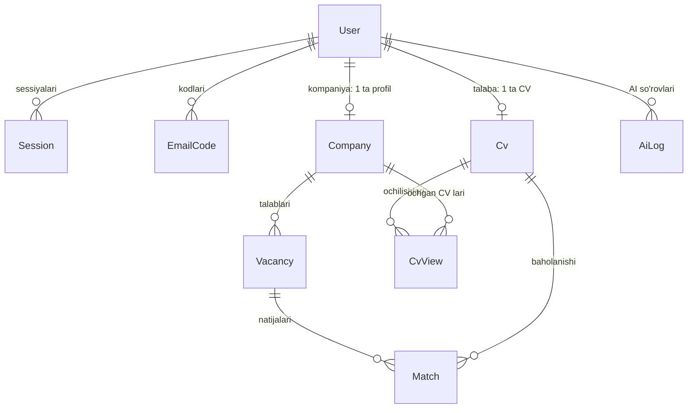

# Jumis AI — ma'lumotlar bazasi sxemasi

PostgreSQL 16, Prisma 6. Manba: `prisma/schema.prisma`. Migratsiyalar: `prisma/migrations/`.
Kengaytma: `pg_trgm` (kalit so'z qidiruvi uchun).

## Aloqalar

- Talaba (`role = STUDENT`) da bitta `Cv`, kompaniya (`role = COMPANY`) da bitta `Company` bo'ladi. Admin da ikkalasi ham yo'q.
- Foydalanuvchi o'chirilsa, uning sessiyalari, kodlari, CV si, kompaniyasi, talablari va natijalari ham o'chadi (`Cascade`). `AiLog` saqlanib qoladi, `userId` bo'shatiladi (`SetNull`), shunda xarajat statistikasi buzilmaydi.

## Jadvallar

### User — foydalanuvchilar

| Maydon               | Turi                            | Izoh                                                |
| -------------------- | ------------------------------- | --------------------------------------------------- |
| id                   | text (cuid)                     | PK                                                  |
| email                | text, **unique**                | kichik harflarda saqlanadi                          |
| passwordHash         | text                            | argon2id xeshi                                      |
| role                 | `STUDENT` / `COMPANY` / `ADMIN` |                                                     |
| status               | `ACTIVE` / `BLOCKED`            | standart `ACTIVE`                                   |
| emailVerifiedAt      | timestamp?                      | email tasdiqlangan vaqt, null = tasdiqlanmagan      |
| locale               | `kk` / `uz` / `ru` / `en`       | interfeys tili                                      |
| consentAt            | timestamp?                      | shaxsiy ma'lumotlarni qayta ishlashga rozilik vaqti |
| createdAt, updatedAt | timestamp                       |                                                     |

Indekslar: `email` (unique), `(role, status)`.

### Session — kirish sessiyalari

| Maydon    | Turi             | Izoh                                                      |
| --------- | ---------------- | --------------------------------------------------------- |
| id        | text             | PK                                                        |
| userId    | → User.id        |                                                           |
| tokenHash | text, **unique** | cookie dagi tasodifiy token xeshi; token o'zi saqlanmaydi |
| expiresAt | timestamp        |                                                           |
| createdAt | timestamp        |                                                           |

Bloklanganda va parol tiklanganda foydalanuvchining barcha sessiyalari o'chiriladi.

### EmailCode — email tasdiqlash va parol tiklash kodlari

| Maydon    | Turi               | Izoh                                                  |
| --------- | ------------------ | ----------------------------------------------------- |
| id        | text               | PK                                                    |
| userId    | → User.id          |                                                       |
| purpose   | `VERIFY` / `RESET` |                                                       |
| codeHash  | text               | kod xeshi; kodning o'zi bazada, javobda va logda yo'q |
| expiresAt | timestamp          | muddati (10 daqiqa)                                   |
| attempts  | int                | noto'g'ri urinishlar soni (eng ko'pi 5)               |
| usedAt    | timestamp?         | ishlatilgan vaqt                                      |
| createdAt | timestamp          |                                                       |

Indeks: `(userId, purpose)`.

Qo'shimcha: bir foydalanuvchi va maqsad bo'yicha so'nggi 24 soatdagi `attempts` yig'indisi 15 dan oshsa, yangi kod bilan ham tekshiruv to'xtaydi (`CODE_DAILY_LIMIT`). Bu kodni qayta-qayta so'rab tanlab topishning oldini oladi.

### Cv — talaba CV si

| Maydon               | Turi                                                   | Izoh                                                                                   |
| -------------------- | ------------------------------------------------------ | -------------------------------------------------------------------------------------- |
| id                   | text (cuid)                                            | PK; AI ga anonim ID sifatida yuboriladi                                                |
| userId               | → User.id, **unique**                                  | bitta talabada bitta CV                                                                |
| language             | `kk` / `uz` / `ru` / `en`                              | CV tili, standart `en`                                                                 |
| sourceText           | text?                                                  | talabaning erkin matni (≤ 3000 belgi)                                                  |
| data                 | jsonb                                                  | CV maydonlari: ism, aloqa, maqsad, ta'lim, tajriba, ko'nikmalar, tillar, sertifikatlar |
| missingFields        | text[]                                                 | AI to'ldira olmagan maydonlar ("to'ldiring")                                           |
| isVisible            | bool                                                   | kompaniyalarga ochiqmi; standart `false`                                               |
| savedAt              | timestamp?                                             | oxirgi saqlash; null = saqlanmagan. CV versiyasi sifatida ham ishlatiladi              |
| skills, languages    | text[]                                                 | filtr maydonlari (saqlashda `data` dan to'ldiriladi)                                   |
| location             | text?                                                  | filtr                                                                                  |
| workTypes            | `FULL_TIME` / `PART_TIME` / `REMOTE` / `INTERNSHIP` [] | filtr                                                                                  |
| searchText           | text                                                   | kalit so'z qidiruvi uchun matn (ism va aloqa ma'lumotisiz)                             |
| createdAt, updatedAt | timestamp                                              |                                                                                        |

Indekslar: `(isVisible, language)`, `skills` (GIN), `searchText` (GIN trigram).

**Kompaniyaga ko'rinadi** faqat: `isVisible = true` va `savedAt IS NOT NULL` va egasi `status = ACTIVE`.

Yozish faqat `saveOwnCv()` orqali (`savedAt`, `missingFields`, filtr maydonlari va `searchText` shu yerda hisoblanadi); `isVisible` ni faqat `setOwnCvVisibility()` o'zgartiradi. PDF va ekrandagi ko'rinish `data` + `language` + `workTypes` dan chiqadi.

### Company — kompaniya profili

| Maydon                                       | Turi                                | Izoh                                                           |
| -------------------------------------------- | ----------------------------------- | -------------------------------------------------------------- |
| id                                           | text                                | PK                                                             |
| userId                                       | → User.id, **unique**               |                                                                |
| name, country, industry, size, contactPerson | text?                               | profil (ro'yxatdan keyin to'ldiriladi)                         |
| logoPath                                     | text?                               | server diskidagi logo yo'li                                    |
| approval                                     | `PENDING` / `APPROVED` / `REJECTED` | standart `PENDING`; faqat `APPROVED` CV larni ko'radi          |
| approvedAt                                   | timestamp?                          |                                                                |
| subscriptionUntil                            | timestamp?                          | obuna faol = `subscriptionUntil > hozir`; AI saralashni yoqadi |
| createdAt, updatedAt                         | timestamp                           |                                                                |

Indeks: `approval`.

`logoPath` faqat server yaratgan fayl nomi (`<companyId>-<uuid>.png|jpg|webp`); fayl `UPLOAD_DIR/logos` da, `public/` da emas, faqat `GET /api/company/me/logo` orqali beriladi.
Ruxsatlar (`lib/company/access.ts` → `companyAccess()`): profil va talab har qanday kompaniyaga; CV ko'rish faqat `APPROVED`; AI saralash `APPROVED` + faol obuna.

### CvView — kompaniya CV ni ochgani

| Maydon    | Turi         | Izoh                        |
| --------- | ------------ | --------------------------- |
| id        | text (cuid)  | PK                          |
| cvId      | → Cv.id      | Cascade                     |
| companyId | → Company.id | Cascade                     |
| pdf       | bool         | `true` = PDF yuklab olingan |
| createdAt | timestamp    |                             |

Indekslar: `(companyId, createdAt)`, `cvId`. Har bir `GET /api/cv/:id` va `/api/cv/:id/pdf` bitta qator yozadi (ism va aloqa ko'rilgan holatlar, ommaviy yig'ishni kuzatish uchun).

### Vacancy — kompaniya talabi

| Maydon               | Turi         | Izoh                                |
| -------------------- | ------------ | ----------------------------------- |
| id                   | text         | PK                                  |
| companyId            | → Company.id |                                     |
| title                | text         | lavozim                             |
| rawText              | text?        | erkin matnli talab (istalgan tilda) |
| skills, languages    | text[]       |                                     |
| minExperienceYears   | int?         |                                     |
| location             | text?        |                                     |
| workType             | WorkType?    |                                     |
| createdAt, updatedAt | timestamp    |                                     |

Indeks: `(companyId, createdAt)` — talablar tarixi.

### Match — saralash natijasi

| Maydon               | Turi                             | Izoh                                                                                                         |
| -------------------- | -------------------------------- | ------------------------------------------------------------------------------------------------------------ |
| id                   | text                             | PK                                                                                                           |
| vacancyId            | → Vacancy.id                     |                                                                                                              |
| cvId                 | → Cv.id                          |                                                                                                              |
| score                | int                              | 0–100                                                                                                        |
| reason               | text                             | 1–2 gaplik izoh                                                                                              |
| hash                 | text                             | sha256(prompt versiyasi, model, izoh tili, Vacancy.updatedAt, Cv.savedAt); mos bo'lsa AI qayta chaqirilmaydi |
| decision             | `NONE` / `SELECTED` / `REJECTED` | kompaniya qarori                                                                                             |
| createdAt, updatedAt | timestamp                        |                                                                                                              |

Indekslar: `(vacancyId, cvId)` unique, `(vacancyId, score)`, `(cvId, decision)` — talabaning "so'rovlari" (`SELECTED`).

### AiLog — AI so'rovlari jurnali

| Maydon                    | Turi               | Izoh                                    |
| ------------------------- | ------------------ | --------------------------------------- |
| id                        | text               | PK                                      |
| task                      | `CV_GEN` / `MATCH` |                                         |
| provider, model           | text               | masalan `anthropic`, `claude-haiku-5-5` |
| inputTokens, outputTokens | int                |                                         |
| costUsd                   | numeric(10,6)      |                                         |
| durationMs                | int                |                                         |
| ok                        | bool               | muvaffaqiyatli bo'ldimi                 |
| errorCode                 | text?              |                                         |
| userId                    | → User.id?         |                                         |
| createdAt                 | timestamp          |                                         |

Indeks: `createdAt` — oylik xarajat hisobi.

### Setting — sozlamalar

| Maydon    | Turi      | Izoh                            |
| --------- | --------- | ------------------------------- |
| key       | text      | PK, masalan `monthlyAiLimitUsd` |
| value     | text      |                                 |
| updatedAt | timestamp |                                 |

## Migratsiya va seed

- Dev: `npm run db:migrate` (yangi migratsiya), `npm run db:seed`.
- Docker / server: `migrate` xizmati `prisma migrate deploy` va `prisma db seed` ni avtomatik bajaradi.
- Seed admin akkauntini `.env` dagi `ADMIN_EMAIL` va `ADMIN_PASSWORD` (≥ 12 belgi) dan yaratadi. Admin allaqachon bo'lsa, paroli o'zgartirilmaydi. `monthlyAiLimitUsd` sozlamasi `AI_MONTHLY_LIMIT_USD` dan (standart 50) faqat birinchi marta yoziladi.
